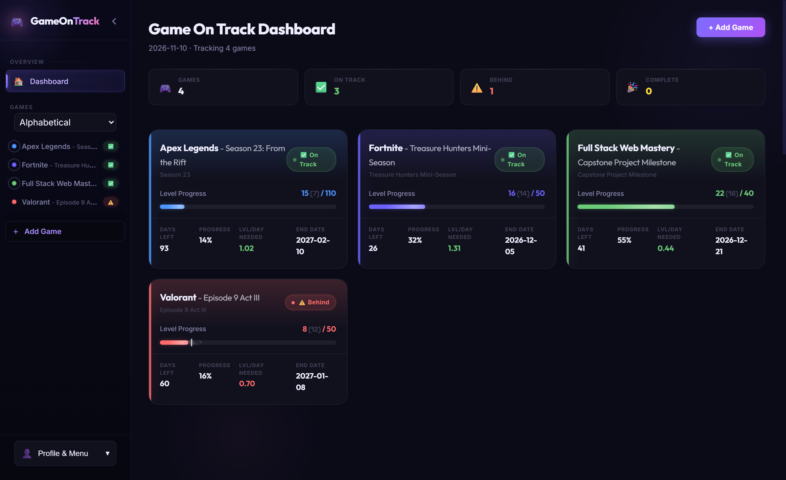
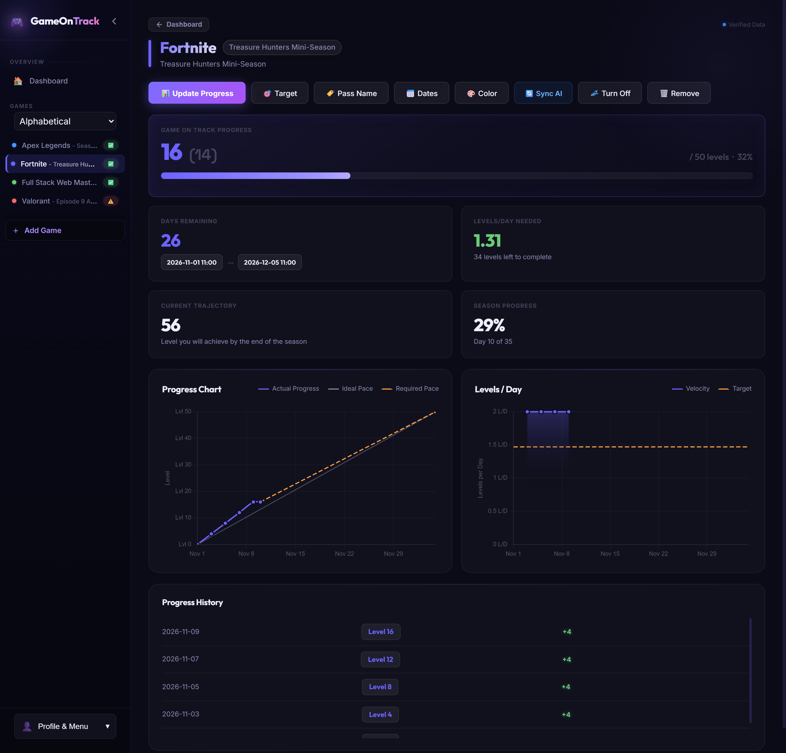
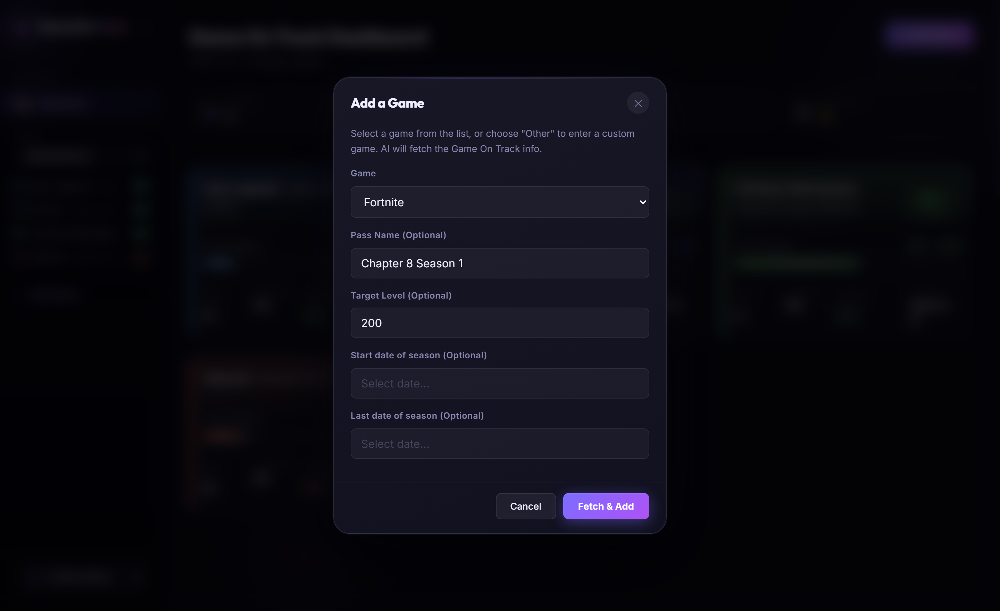
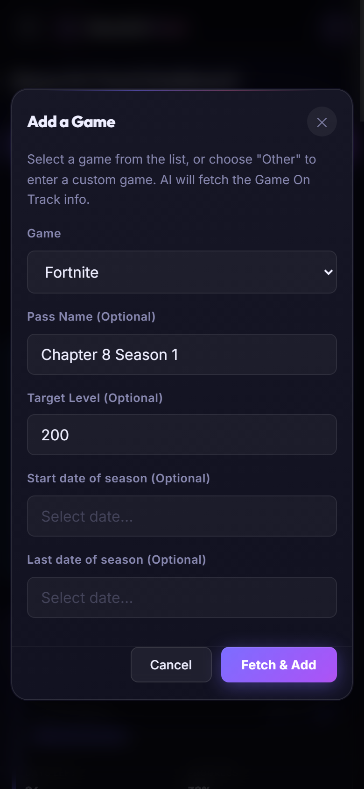
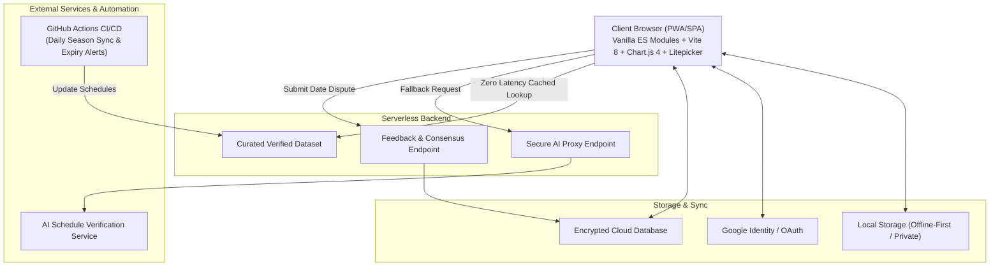

  <h1>🎮 Game On Track</h1>
  
<strong>A modern, AI-driven, and community-verified web application designed to track seasonal battle passes, compute daily velocity, and ensure you finish your goals on time.</strong>

  
  
  
  

 

  

> [!NOTE]
> **Public Showcase & Releases Repository:** The core application source code and backend infrastructure are maintained in a secure private repository to safeguard serverless configurations, environment secrets, and backend validation logic. This public repository (`Game-On-Track-Releases`) serves as the official public showcase, release tracker, and community feedback hub.

---

## 📖 Table of Contents
- [✨ The Problem & The Solution](#-the-problem--the-solution)
- [🌟 Comprehensive Feature List](#-comprehensive-feature-list)
  - [🤖 AI Intelligence & Curated Season Data](#-ai-intelligence--curated-season-data)
  - [👥 Community Verification & Feedback System](#-community-verification--feedback-system)
  - [📊 Advanced Tracking, Goals & Velocity](#-advanced-tracking-goals--velocity)
  - [📈 Interactive Data Visualization](#-interactive-data-visualization)
  - [🎨 Mobile-First UI, Gestures & Drag-and-Drop](#-mobile-first-ui-gestures--drag-and-drop)
  - [🔒 Security, Resilience & Cloud Sync](#-security-resilience--cloud-sync)
- [🛠️ Architecture & Tech Stack](#%EF%B8%8F-architecture--tech-stack)
- [🛡️ Enterprise-Grade Security Highlights](#%EF%B8%8F-enterprise-grade-security-highlights)
- [🚀 Try the Live Application](#-try-the-live-application)
- [💬 Feedback, Issues & Recruiter Inquiries](#-feedback-issues--recruiter-inquiries)

---

## ✨ The Problem & The Solution

Modern multiplayer titles rely heavily on seasonal battle passes (Fortnite, Valorant, Apex Legends, Call of Duty, etc.). Players often juggle passes across 3 or 4 games at once, each with different start dates, end dates, tier requirements, and XP curves. The result is often the same: missed rewards, wasted money, or stressful end-of-season all-nighter grinds.

**Game On Track** solves this by transforming passive pass progression into an active, data-driven experience:
* Automatically stays current on season schedules via a zero-latency curated database and an AI web-search fallback.
* Computes exact daily leveling targets (**Levels per Day - L/D**) and displays your pace status in real time (**On Track**, **Behind**, or **Complete**).
* Offers deep customization: custom starting tiers, milestone targets, prestige overflow tracking, and a guilt-free **Paused Mode** for when you need a break.
* Works seamlessly across both desktop and mobile devices with real-time cloud synchronization.

---

## 🌟 Comprehensive Feature List

### 🤖 AI Intelligence & Curated Season Data
* **Curated Game Dates Database:** Built-in verified database covering 13+ major titles (Fortnite, Valorant, Apex Legends, Call of Duty, BGMI, PUBG Mobile, Overwatch 2, Rocket League, Destiny 2, Genshin Impact, Diablo 4, Halo Infinite, The Finals, and more). Queries resolve instantly with zero latency, verified accuracy, and complete immunity to AI hallucinations.
* **AI-Powered Schedule Lookup:** For unlisted or custom games, queries automatically fall through to a resilient serverless AI pipeline that searches official public announcements and schedule releases to retrieve verified season dates.
* **Server-Side Date Validation:** Strict sanity checks validate date formats, reject expired seasons, block implausibly long durations (> 180 days), and clamp levels to realistic boundaries (1–500).
* **Automated Daily Sync & Expiry Alerts:** A daily GitHub Actions automation checks season health, updates schedules via official APIs and verified automated lookups, and opens alert issues for seasons expiring within 3 days.
* **Verified Data Badges:** Distinguishes between hand-curated schedules (blue `Verified Data` badge) and AI-fetched dates (`Fetched [Date]` badge).
* **Staleness & Expiry Warnings:** Intelligently alerts you when season data is older than 3 days or when a season has officially concluded, prompting a one-click refresh.

### 👥 Community Verification & Feedback System
* **Interactive Accuracy Checks:** An automated feedback prompt appears when loading a game's detail view for the first time or after dates are updated, asking users to confirm accuracy.
* **Crowdsourced Date Suggestions:** Disputing dates opens an embedded calendar form allowing players to submit suggested start and end dates directly to the community database.
* **Trust-Weighted Consensus:** Submissions are weighted through a consensus scoring model that verifies accuracy, flags disputed schedules, and protects community data against coordinated manipulation.

### 📊 Advanced Tracking, Goals & Velocity
* **Multi-Game & Custom Goal Tracking:** Track an unlimited library of games simultaneously or define custom non-game goals, seasonal milestones, and personal challenge tracks using the **"Other (Custom Game / Goal)"** mode.
* **Custom Starting Positions:** Define a starting level/position (e.g., Level 20 instead of Level 0). All pace calculations, expected daily levels, progress bars, and velocity graphs calibrate to your actual starting point.
* **Progress Beyond Target (Overflow / Prestige Tiers):** No artificial caps—continue recording levels past your target or 100% completion to track bonus, prestige, and overflow tiers.
* **Custom Target Levels:** Don't want to grind to the maximum tier? Set a custom target (e.g., Level 50 instead of 100), and all trajectory calculations and charts dynamically adjust to your personal milestone.
* **Velocity Tracking (Levels/Day):** Accurately calculates the exact levels per day (L/D) required to complete your goals before the deadline.
* **Pace Status & Trajectory:** Instantly informs you whether you are **On Track**, **Behind**, or **Complete**, calculates your expected level for today, and projects your final level if you maintain your current pace.
* **Game Deactivation & Paused Mode:** Deactivate games you aren't currently playing to move them to a dedicated "Deactivated Games" section. Deactivated games feature a **neutralized, stress-free interface** (💤 badge, muted gray accents, zeroed expected progress, and hidden urgency stats) so taking a break never creates pressure.
* **Recycle Bin (30-Day Retention):** Accidentally removed a game? Deleted games are moved to a Recycle Bin with a 30-day retention window. Easily restore them or permanently delete them with real-time bin badge counts.
* **Detailed History Log:** Chronological log of every progress update, tracking dates, levels achieved, and net delta (+/- levels).

### 📈 Interactive Data Visualization
* **Progress Chart:** Interactive line chart (powered by Chart.js 4 and date-fns) comparing your **Actual Progress** against the **Ideal Pace** and the **Required Pace** needed to finish on time, cleanly starting from your custom starting position.
* **Velocity Chart:** Visualizes your historical daily leveling velocity plotted against the required target velocity baseline.

  

### 🎨 Mobile-First UI, Gestures & Drag-and-Drop
* **Mobile-First Responsive Interface:** Complete with a dedicated mobile header, safe-area insets (`viewport-fit=cover`), touch-friendly targets, and a quick-add `+` button.
* **Desktop & Touch Drag-and-Drop Reordering:** Freely reorder games on both desktop (mouse drag) and mobile devices (long-press touch drag with floating preview and drop guides).
* **Litepicker Calendar Integration:** Clean, bundled dark-mode datepicker matching the app's cyberpunk neon aesthetic across Add Game modals, Manual Date Overrides, and Date Feedback forms.
* **Collapsible Sidebar:** Toggle the sidebar between expanded and compact icon-only view on desktop to maximize dashboard screen real estate.
* **Mobile Drawer Gestures:** Swipe left (-60px threshold), tap the backdrop, or press Escape to close the mobile drawer with locked background scrolling.
* **Advanced Sorting:** Sort your library alphabetically, by season start date, season end date, levels/day urgency, or your custom drag-and-drop order.
* **Custom Game Colors:** Personalize each game card with preset glowing palettes or pick any color using the dual-canvas Hex/Hue/SV color picker.
* **Terminology Tooltips:** Helpful hover tooltips explain domain jargon (velocity, expected level, pace trajectory) for new users.

  
  

### 🔒 Security, Resilience & Cloud Sync
* **Offline-First Architecture:** Fully functional without an account or internet connection. Game progress is saved locally and privately in browser storage with strict import schema validation.
* **Real-Time Cloud Sync:** Sign in with Google to securely sync your game library and history across all your devices using encrypted cloud synchronization.
* **Sync Manager & Auto-Retry:** Features a real-time status indicator (Idle, Syncing, Synced, Error), actionable error toasts with instant "Retry", automatic background retry on transient errors, and an 8-second timeout guard to prevent app freezes.
* **Exit Guard:** Warns you if you attempt to close or navigate away from the page while changes are pending cloud save.
* **Secure Backend Proxy:** AI and feedback services run in serverless proxy functions, keeping all API keys and service credentials strictly hidden from client bundles.

---

## 🛠️ Architecture & Tech Stack

| Layer | Technologies & Tools |
| :--- | :--- |
| **Frontend Core** | Vanilla JavaScript (Modular ES Modules), Vite 8, Modern Semantic HTML5 |
| **Styling & Design System** | Modern CSS3 Design Tokens, Custom Glassmorphism, Responsive Grid / Flexbox |
| **Data Visualization** | Chart.js 4, `chartjs-adapter-date-fns`, `date-fns` v4 |
| **Calendar & Pickers** | Litepicker (Dark Themed), Dual-Canvas Hex/Hue/SV Color Picker |
| **Backend / Serverless** | Vercel Serverless Functions (Node.js), Secure Token Verification, CORS Controls |
| **AI & Web Search** | Resilient Serverless AI Pipeline (Multi-model fallback & web discovery) |
| **Database & Identity** | Google Authentication & Encrypted Cloud Storage |
| **CI/CD & Automation** | GitHub Actions (Daily season date validation, expiry alerts, Node.js 24) |

---

## 🛡️ Enterprise-Grade Security Highlights

* **Strict Content Security Policy (CSP):** Complete elimination of inline scripts with strict origin pinning (`script-src 'self'`).
* **Subresource Integrity (SRI):** Pinned CDN versions and cryptographic SRI hashing.
* **Event Delegation:** Architecture uses declarative `data-action` delegation, eliminating risky eval patterns and dynamic event injections.
* **Server-Side Input Sanitization:** Robust regex validation and prompt injection defenses before forwarding queries to LLMs.
* **Sliding-Window Rate Limiting:** Enforces server-side rate limits to protect APIs from abuse and denial-of-wallet vectors.
* **HTTP Hardening Headers:** Strict-Transport-Security (HSTS), `X-Frame-Options: DENY`, `X-Content-Type-Options: nosniff`, and `Referrer-Policy: strict-origin-when-cross-origin`.

---

## 🚀 Try the Live Application

You can explore the live application immediately. No account or setup is required to test local tracking:

👉 **[Launch Game On Track](https://game-on-track.vercel.app/)**

* **Guest Mode:** All data stays locally stored in your browser's persistent storage.
* **Google Sign-In:** Enable real-time cross-device cloud synchronization.

---

## 💬 Feedback, Issues & Recruiter Inquiries

* **Bug Reports & Game Requests:** If you notice an outdated season date or have a feature request, please [open an issue](https://github.com/itsArK-27/Game-On-Track-Releases/issues) right here in this repository!
* **Recruiter & Engineering Inquiries:** If you are a recruiter, engineering manager, or reviewer interested in the technical decisions, code quality, or private source code of this application, I would be delighted to connect and walk you through the architecture in detail.
